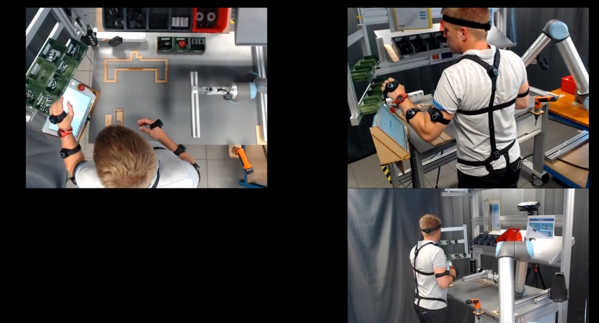
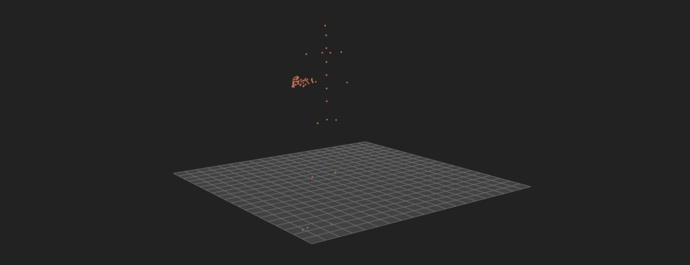

# Predicting Human Motion in Human–Robot Collaboration Using PINNs and Computer Vision

A Physics-Informed Neural Network (PINN) approach that combines vision-based human tracking with human biomechanics to anticipate human arm/hand motion **100–500ms ahead** during human-robot collaboration tasks.


---

## 1. Problem Statement

Collaborative robots today are *reactive* — they see what a human has already done and respond after the fact. This delay creates jerky handovers and a safety gap.

**Goal:** Build the *anticipation layer* — predict where a human's arm/hand will be a short time into the future, so a robot controller could later use this to move proactively and safely. This project does **not** build the robot's response/control logic itself.

---

## 2. Why PINNs (Not RL or Plain Deep Learning)

| Approach | Why it falls short here |
|---|---|
| Reinforcement Learning | No action/reward signal exists for a pure forecasting problem; data-hungry; generalizes poorly to unseen human motion |
| Plain Deep Learning (LSTM/Transformer only) | Can predict motion, but with nothing enforcing physical laws it can output physically impossible trajectories (unrealistic accelerations, position jumps) |
| **Physics-Informed Neural Network (PINN)** | Trained on real data **and** constrained by human biomechanics equations → smooth, realistic predictions, robust to noisy/incomplete vision input |

---

## 3. Approach Overview

Two technologies, one pipeline:

- **Computer Vision (CV)** — the "eyes." Estimates current joint positions/angles frame-by-frame from video.
- **PINN** — the "understanding." Takes the CV joint stream and predicts the next 100–500ms of motion, constrained by biomechanics equations (rigid-body joint dynamics).

**Training:** noisy CV-estimated trajectory + clean IMU-based trajectory (ground truth + biomechanics constraint computation).
**Deployment:** camera only — no motion-capture suit needed.

---

## 4. Dataset — InHARD (Industrial Human Action Recognition Dataset)

Chosen over the alternative (ACTIVE, better suited for long-range whole-body action recognition) because InHARD offers precise, joint-level, dual-modality data.

| Property | Details |
|---|---|
| Scale | 2,000,000+ frames, 4,800+ action samples, 16 subjects |
| Action classes | 13 industrial actions (assembling, tool use, passing items to a cobot) |
| Skeleton data | 17 body joints, 3D position + rotation, 120Hz, IMU suit (Perception Neuron 32), BVH files |
| RGB data | 3 synchronized camera views (top, left-45°, right-45°) |
| Robot involved | UR10 collaborative arm |

---

## 5. Vision Pipeline (3D Motion Extraction)

- **Multi-view triangulation (preferred):** use the 3 synced camera views + calibration params → accurate 3D joint positions.
- **Monocular 3D pose lifting (fallback):** single-view 3D pose estimation when calibration isn't available — noisier, but more realistic for a single-camera deployed robot; this is where the PINN's physics constraint matters most.

---

## 6. Biomechanics Scope

| Level | Modeled | Used? |
|---|---|---|
| Joint kinematics | Positions/angles only | Baseline input, not the constraint |
| **Joint dynamics (rigid-body)** | Net torque per joint via anthropometric tables | ✅ Used — this is the physics constraint |
| Muscle-level (Hill-type) | Individual muscle forces (needs EMG/OpenSim) | ❌ Future work, out of scope |

---

## 7. Loss Function

```
L = λ1·L_data + λ2·L_dynamics + λ3·L_smoothness + λ4·L_limits
```

| Term | Enforces |
|---|---|
| L_data | Predicted trajectory matches observed continuation |
| L_dynamics | Satisfies M(q)q̈ + C(q,q̇)q̇ + G(q) = τ (rigid-body dynamics, anthropometric params, e.g. de Leva 1996) |
| L_smoothness | Minimum-jerk-like, non-jerky predicted paths |
| L_limits | Penalizes exceeding realistic joint angle/velocity/torque limits |

---

## 8. Scoping

- **Phase 1 (current target):** Upper body only — shoulder–elbow–wrist chain (3-joint arm model). Covers handover, reaching, proximity-safety.
- **Phase 2 (optional/stretch):** Full-body dynamics for general industrial actions.

## 9. Explicitly Out of Scope

- Robot response/control logic
- Muscle-level force/activation modeling (possible future OpenSim extension)
- Reinforcement learning

---

## 10. Evaluation Plan

Compare PINN vs. a non-physics-informed baseline (LSTM/Transformer, same trajectories, no physics loss) on:

- **Accuracy:** MPJPE at 100ms / 200ms / 500ms horizons
- **Physical plausibility:** bone-length consistency, joint-limit violations
- **Data efficiency:** performance at 100% / 50% / 10% of training data
- **Occlusion robustness:** performance when parts of input trajectory are masked

---

## 11. End-to-End Pipeline

1. **Data** — InHARD RGB (noisy input) + IMU skeleton (clean supervision), synchronized
2. **Vision** — extract 3D joint trajectories (triangulation or monocular lifting)
3. **Physics setup** — compute anthropometric params + joint-torque dynamics via inverse dynamics from IMU skeleton
4. **Model** — train PINN on short observed window → predict next 100–500ms, combined data+physics loss
5. **Evaluation** — compare against baseline on accuracy, plausibility, data efficiency, occlusion robustness

---

## Progress Checklist

> Update this as code is added. Check off items as they're completed.

### Step 1 — Data
- [x] Explore and understand InHARD dataset structure (BVH skeleton + RGB videos)
- [x] Confirm dataset choice over ACTIVE alternative
- [x] Download / set up InHARD dataset locally
- [x] Write data loader for IMU skeleton (BVH files)
- [x] Write data loader for synchronized RGB video (3 views)
- [x] Synchronize IMU + RGB streams per action sample
- [ ] Train/val/test split strategy

### Step 2 — Vision Pipeline
- [ ] Obtain/verify camera calibration parameters for InHARD views
- [ ] Implement 2D keypoint detection per camera view
- [ ] Implement multi-view triangulation → 3D joint positions
- [ ] Implement monocular 3D pose lifting (fallback path)
- [ ] Validate CV-extracted joints against IMU ground truth (sanity check)

### Step 3 — Physics Setup
- [ ] Implement anthropometric body-segment parameter tables (de Leva 1996 or equivalent)
- [ ] Implement inverse dynamics from IMU skeleton (compute τ per joint)
- [ ] Restrict to shoulder–elbow–wrist chain (Phase 1 scope)
- [ ] Validate computed dynamics against known biomechanics benchmarks

### Step 4 — Model (PINN)
- [ ] Define input windowing (observed trajectory window → prediction horizon)
- [ ] Implement base network architecture (encoder + predictor)
- [ ] Implement L_data loss term
- [ ] Implement L_dynamics loss term (physics constraint)
- [ ] Implement L_smoothness loss term (minimum-jerk)
- [ ] Implement L_limits loss term (joint angle/vel/torque limits)
- [ ] Combine into total loss L with tunable λ weights
- [ ] Train baseline (non-physics) model — LSTM/Transformer
- [ ] Train PINN model
- [ ] Hyperparameter tuning (λ weights, window size, horizon)

### Step 5 — Evaluation
- [ ] Implement MPJPE metric at 100ms/200ms/500ms
- [ ] Implement bone-length consistency check
- [ ] Implement joint-limit violation counter
- [ ] Run data efficiency experiment (100%/50%/10% training data)
- [ ] Run occlusion robustness experiment (masked input segments)
- [ ] Compile comparison results: PINN vs baseline
- [ ] Write up findings / final report

### Stretch Goals (Phase 2+)
- [ ] Extend to full 17-joint body model
- [ ] Explore muscle-level (Hill-type / OpenSim) extension
- [ ] Real-time inference pipeline (camera-only, no IMU) demo

---

